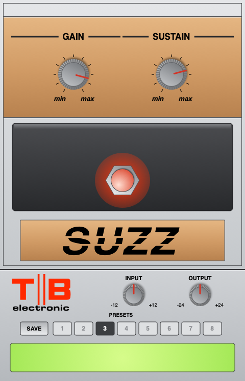

# TB Suzz (2026 Mac)

The TB Suzz fuzz for current Macs: **CLAP, VST3 and AU**, universal (Apple Silicon
and Intel), **macOS 11 and later**. Use it in Reaper, FL Studio, Logic, GarageBand,
Tape16 and other hosts.

The sound and panel are the same as the Mac OS X 10.8 VST build
([TB-Suzz-Mountain-Lion](https://github.com/tonybuzzcock/TB-Suzz-Mountain-Lion)).
The DSP code is the same, and the test suite checks that the plugin's output matches
it sample for sample. It's a model of the Carlsbro Suzz, built from its schematic.
Personal, non-commercial use.

## Install

GitHub → Actions → latest run → Artifacts → `TB-Suzz-mac`, unzip, then follow
`INSTALL.txt`. In short:

- `TB Suzz.vst3` → `VST3/`
- `TB Suzz.component` → `Components/`
- `TB Suzz.clap` → `CLAP/`

These folders are in `/Library/Audio/Plug-Ins/` (the main Library) or
`~/Library/Audio/Plug-Ins/` (your user Library). Use whichever one your other plugins
are in. Apple hasn't notarised the plugins, so run the short Terminal lines in
`INSTALL.txt` for the folder you used. They clear macOS's download tags and re-sign the
plugins on your Mac. Then rescan plugins in your DAW.

## Controls

| Name | Control | Range |
|------|---------|-------|
| Gain | P2, the output level (470R, audio taper assumed) | 0 – 10 (min/max on the panel) |
| Sustain | P1, the 741's gain (22K reverse log): x22 to x1000 | 0 – 10 (min/max on the panel) |
| Effect | the stomp switch: effect in, or straight through | In / Out |
| Input | *plugin only*: level into the pedal (1.0 = 1 V) | ±12 dB |
| Output | *plugin only*: output trim | ±24 dB |

Gain defaults to 8.5, where the effect is about as loud as the bypass. In stereo,
each side runs through its own copy of the circuit with the same settings; a mono
source is processed once.

## The panel

480 × 748 portrait, laid out like the pedal: a short top rail, the bronze GAIN and
SUSTAIN section, the charcoal treadle with the stomp switch (glows red with the effect
in), and the bronze name plate with SUZZ in Shatter-style lettering (drawn in code; no
font file). The strip along the bottom has the TB electronic logo, Input, Output,
presets and the readout.

Drag a knob up or down to turn it (hold Shift for fine control). Double-click a knob
to reset it, or use the scroll wheel. Click the stomp switch to switch the effect in
or out.

**Presets:** click SAVE, then a slot 1–8. Click a saved slot to recall it. The presets
are shared by all three formats, in
`~/Library/Application Support/TB/TB Suzz/Presets.txt`.

## What's modelled

The whole pedal as one circuit: C1 into the 741 biased at half the 9 V battery, R3 / C3
feedback with R4 / C2 into SUSTAIN, then C4, R5, R6 / C5 and the 470-ohm GAIN pot.
The 741 has its 1 MHz gain-bandwidth, 0.5 V/us slew and a slightly lopsided output
swing on one 9 V battery. The swing, the guitar's pickup and cable, and GAIN's taper
aren't fixed by the drawing, so they're estimated; each is a named constant in
`Source/DSP/Suzz.cpp`. The 10.8 build's README has the full circuit notes.

## How it's built

The plugin is written once as a CLAP (`Source/Plugin`).
[clap-wrapper](https://github.com/free-audio/clap-wrapper) v0.17.0 builds the VST3 and
AU from that same code. The SDKs are downloaded at configure time:

    cmake -B build -DCMAKE_BUILD_TYPE=Release
    cmake --build build --config Release

GitHub Actions builds universal binaries and fails unless every plugin has both
architectures and a macOS 11.0 minimum. It ad-hoc signs the plugins, then:

- runs the DSP, preset and CLAP host tests (native and the other architecture)
- opens the panel offscreen through the CLAP GUI extension and drives its controls
- validates with auval (`aufx TBsz TBel`), clap-validator and pluginval
- publishes panel screenshots to the `gui-preview` branch

A Linux job builds the CLAP and runs the same tests.
